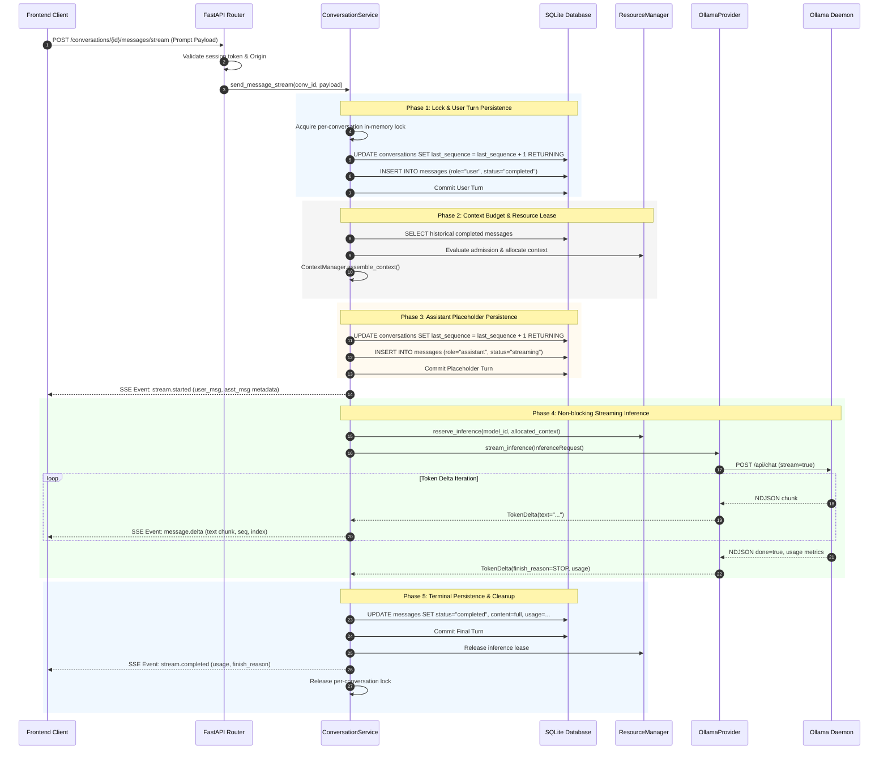
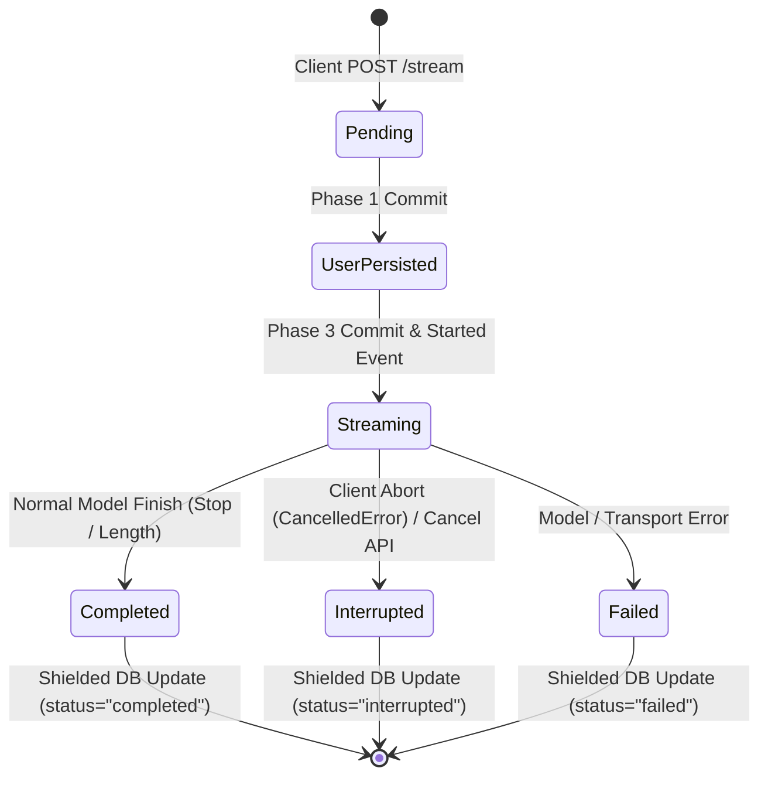

# ORBIT M1.5 — Streaming Transport Architecture & Technical Specification

**Milestone:** M1.5 — Streaming Transport  
**Status:** PROPOSED & READY FOR IMPLEMENTATION  
**Author:** ORBIT Core Architecture Group  
**Target Platform:** macOS (Apple Silicon M4, 16 GB Unified Memory)  
**Baseline Git Checkpoint:** `c1e07e62a6ecdce09e84df99272d4ccd68542ebc` (main)  
**Parent Milestones:** M0 (Foundation), M1.1 (Contracts), M1.2 (Ollama Provider), M1.3 (Resource Manager), M1.4 (Persistence & Context)

---

## 1. Executive Summary & Purpose

### 1.1 Objective
ORBIT is a local-first, privacy-focused Autonomous Personal Intelligence Runtime engineered for macOS. In Milestone M1.4, durable SQLite conversation persistence, atomic sequence assignment, crash recovery reconciliation, and dynamic token-budget context assembly were fully implemented and frozen. However, M1.4 exposed only a synchronous blocking request/response endpoint (`POST /api/v1/conversations/{conversation_id}/messages`). For large local models running on Apple Silicon (e.g., Llama 3.2 3B, Mistral 7B), Time-To-First-Token (TTFT) and full turn generation can span several seconds, causing perceived frontend unresponsiveness and preventing real-time user cancellation.

Milestone **M1.5: Streaming Transport** introduces real-time, low-latency, bi-directional lifecycle token delivery from the local inference provider to the Tauri desktop client.

### 1.2 Core Capabilities
1. **Incremental Token Delivery:** Expose a standardized Server-Sent Events (SSE) endpoint (`POST /api/v1/conversations/{conversation_id}/messages/stream`) streaming token deltas as they are generated by the local AI engine.
2. **Deterministic Lifecycle Events:** Transmit typed, sequenced protocol events (`stream.started`, `message.delta`, `stream.completed`, `stream.interrupted`, `stream.failed`, `stream.ping`).
3. **Immediate Cancellation Propagation:** Provide dual-path cancellation—native HTTP connection teardown (via `AbortController` in the client) and explicit REST cancellation (`POST /api/v1/conversations/{conversation_id}/cancel`)—that immediately halts downstream Ollama generation and releases hardware inference leases.
4. **Resilient Persistence Invariants:** Preserve all M1.4 ACID guarantees: user prompts committed upfront, assistant placeholder committed with `status="streaming"`, zero SQLite locks held across inference, and guaranteed shielded persistence of partial tokens with `status="interrupted"` upon cancellation or disconnection.
5. **Zero New External Dependencies:** Utilize native Starlette `StreamingResponse` and standard Python `asyncio` constructs on the backend, alongside standard Web Streams (`ReadableStreamDefaultReader`) on the frontend.
6. **Strict Milestone Boundaries:** Zero frontend UI components (no desktop chat screens, sidebars, or stop buttons) are created in M1.5; M1.5 delivers the complete backend transport and TypeScript client contract ready for M1.6 UI integration.

---

## 2. Repository Discovery & Baseline Architecture Audit

A thorough inspection of the frozen repository at commit `c1e07e62a6ecdce09e84df99272d4ccd68542ebc` confirms the existing capabilities and integration points:

```
+---------------------------------------------------------------------------------------------------------+
|                                        ORBIT RUNTIME ARCHITECTURE                                       |
+---------------------------------------------------------------------------------------------------------+
| [Frontend (Tauri Shell)]                                                                                |
|    BackendClient (IPC) <---> Tauri IPC (`get_backend_connection`) ---> Local Ephemeral Session Token    |
+---------------------------------------------------------------------------------------------------------+
| [FastAPI Application (`app.main`)]                                                                      |
|    Lifespan Context: DB Engine, Watchdog, Crash Recovery Reconciler, ResourceManager, ModelRegistry    |
|    Security Middleware: `require_session_auth` (Origin validation + `x-orbit-session-token` check)       |
+---------------------------------------------------------------------------------------------------------+
| [Service Layer (`app.services.conversation_service`)]                                                   |
|    _LockEntry: Per-conversation in-memory serialization with ref-counted cleanup                        |
|    SQLite Sequence Assignment: Atomic `UPDATE conversations SET last_sequence = last_sequence + 1`      |
|    ContextManager: Headroom calculation, sliding window truncation, system prompt assembly              |
+---------------------------------------------------------------------------------------------------------+
| [Provider Abstraction & Engine (`app.ai`)]                                                              |
|    ResourceManager: Memory headroom verification, `reserve_inference` lease, dynamic context reduction |
|    OllamaProvider: Native NDJSON client (`/api/chat`), `stream_inference()`, `cancel_inference()`       |
|    RequestContext & ModelLifecycleTracker: Active inference ref-counts, cooperative cancellation event  |
+---------------------------------------------------------------------------------------------------------+
```

### 2.1 Critical Audit Findings
1. **OllamaProvider is Already Streaming:** In `backend/app/ai/providers/ollama.py`, `OllamaProvider.stream_inference()` is already implemented as an asynchronous generator yielding `TokenDelta` objects from Ollama's `/api/chat` NDJSON stream. In M1.4, `ConversationService.send_message()` consumed this generator internally into an in-memory list before persisting the completed message.
2. **Cooperative Cancellation is Built-In:** `OllamaProvider.cancel_inference(request_id)` exists and operates by:
   - Setting `req_ctx.cancel_event = asyncio.Event()`.
   - Closing `req_ctx.response.aclose()` on the active `httpx.Response`.
   - Decrementing `tracker.active_inferences` and setting `tracker.inferences_drained`.
3. **Resource Safeguards are Integrated:** `ResourceManager.reserve_inference()` yields an async context manager tracking active memory leases. If the stream is abruptly terminated or cancelled, the lease must be released deterministically in an `async with` or `finally` block.
4. **Database Schema Requires Zero Migrations:** The `Message` model (`backend/app/models/conversation.py`) already defines `status: Mapped[str] = mapped_column(String(16))` with documented support for `"streaming"`, `"completed"`, `"interrupted"`, and `"failed"`.
5. **Startup Crash Recovery Exists:** `ConversationService.reconcile_crashed_generations()` already checks for `Message.status.in_(["streaming", "pending"])` and safely converts dangling in-flight rows to `"interrupted"` on reboot.
6. **Authentication Architecture:** `require_session_auth` checks both the `x-orbit-session-token` header and the `Origin` header (validating `tauri://localhost`, `http://localhost:1420`, etc.). For standard EventSource clients that cannot send custom headers, query parameter authentication (`?token=...`) must be supported or standard `fetch()` with custom headers must be utilized.

---

## 3. Transport Protocol Selection: SSE vs. WebSockets vs. Chunked JSON

Selecting the transport protocol determines connection complexity, memory overhead, cancellation semantics, and OpenAPI compatibility.

### 3.1 Comparison Matrix

| Evaluation Dimension | Server-Sent Events (SSE) | WebSockets (Multiplexed) | Chunked NDJSON (`Transfer-Encoding`) |
| :--- | :--- | :--- | :--- |
| **Protocol Model** | Standard HTTP/1.1 or HTTP/2 unidirectional text stream | Full duplex persistent bidirectional socket | Standard HTTP chunked transfer |
| **Request Framing** | Native `text/event-stream` with typed events (`event: ...\ndata: ...\n\n`) | Custom binary or JSON framing protocol over WS frames | Raw newline-delimited JSON (`\n`) |
| **Client Support** | Native `fetch()` ReadableStream or `EventSource` in WebKit | Native `WebSocket` in WebKit/Browser | Native `fetch()` ReadableStream |
| **Cancellation Handling** | **Direct & Native:** Calling `AbortController.abort()` closes HTTP request, immediately triggering `asyncio.CancelledError` on Starlette server | Requires application-level RPC cancel message framed over socket | Direct: `AbortController.abort()` drops TCP stream |
| **Error Signaling** | Standard HTTP status codes (400, 401, 404, 429, 500) before stream starts; typed `stream.failed` events if failure occurs mid-stream | Requires custom error envelopes over socket or WS close codes | HTTP status codes upfront; malformed JSON if failure occurs mid-stream |
| **OpenAPI / REST Fit** | **High:** Maps 1:1 with REST conversation resources (`POST /conversations/{id}/messages/stream`) | **Low:** Bypasses REST router; requires ad-hoc message dispatcher | Moderate: Fits REST, but lacks typed event boundaries |
| **FastAPI / Starlette** | Native `StreamingResponse(generator, media_type="text/event-stream")` | Requires `APIRouter.websocket()` and connection manager registry | Native `StreamingResponse(generator, media_type="application/x-ndjson")` |
| **Connection Overhead** | Minimal: Ephemeral connection per message turn | High: Long-lived duplex state, ping/pong heartbeats, reconnection logic | Minimal: Ephemeral connection per turn |

### 3.2 Decision & Rationale
**Selected Transport: Server-Sent Events (SSE) over HTTP (`text/event-stream`)**

**Rationale:**
1. **Unidirectional Semantic Fit:** An LLM conversational turn is fundamentally request-response where the response is streamed incrementally. Full-duplex communication is unnecessary overhead for text completion.
2. **Deterministic HTTP Abort:** When a frontend user clicks "Stop Generating" or navigates away, the frontend triggers `AbortController.abort()`. In Starlette, this immediately raises `asyncio.CancelledError` inside the active endpoint generator. No secondary WebSocket control frame parsing or race conditions can occur.
3. **Clean Decoupling from Telemetry:** ORBIT already maintains a dedicated WebSocket for system telemetry (`/ws`). Multiplexing heavy text streaming over the telemetry socket would introduce head-of-line blocking and complex framing, whereas SSE isolates conversational turns to their respective REST endpoints.
4. **Standard Web Standards:** Both modern WebKit (macOS Tauri) and standard browser environments support streaming `fetch()` with `ReadableStream` natively, enabling simple client-side parsing without heavy third-party libraries.

---

## 4. End-to-End System Architecture & Data Flow

### 4.1 System Component Diagram

```mermaid
flowchart TD
    subgraph Frontend ["Tauri Desktop (Frontend)"]
        UI["Chat View (M1.6)"]
        SC["StreamClient (fetch + AbortController)"]
        UI -->|Send Prompt| SC
        UI -.->|User clicks Stop| SC
    end

    subgraph API ["FastAPI HTTP Gateway"]
        Auth["require_session_auth<br/>(Header / Origin / Token)"]
        Route["POST /conversations/{id}/messages/stream"]
        SR["Starlette StreamingResponse<br/>(text/event-stream)"]
        Auth --> Route
        Route --> SR
    end

    subgraph Core ["ConversationService (Orchestrator)"]
        Lock["_acquire_conversation_lock<br/>(Ref-counted in-memory)"]
        Seq["SQLite Atomic Sequence<br/>(UPDATE ... RETURNING)"]
        Ctx["ContextManager<br/>(Headroom & History)"]
        Gen["send_message_stream()<br/>(Async Generator)"]
    end

    subgraph Engine ["AI Provider Layer"]
        RM["ResourceManager<br/>(Memory Lease & Headroom)"]
        Reg["ModelRegistry"]
        Ollama["OllamaProvider<br/>(stream_inference)"]
        Daemon["Ollama Daemon<br/>(/api/chat NDJSON)"]
    end

    subgraph Storage ["SQLite Database (WAL Mode)"]
        DB[(orbit.db)]
    end

    SC -->|HTTP POST + Auth| Auth
    Route --> Lock
    Lock --> Seq
    Seq -->|Persist User Turn (completed)| DB
    Seq --> Ctx
    Ctx -->|Query history| DB
    Ctx --> RM
    RM -->|Acquire lease| Ollama
    Ollama -->|NDJSON Stream| Daemon
    Daemon -->|Token chunks| Ollama
    Ollama -->|TokenDelta| Gen
    Gen -->|SSE Event Framing| SR
    SR -->|text/event-stream| SC
    SC -->|Typed Events| UI
    Gen -->|Persist Assistant Turn (completed / interrupted)| DB
```

### 4.2 Turn Execution & Event Lifecycle Sequence



---

## 5. SSE Event Protocol Specification

All streaming responses use standard MIME type `text/event-stream`. Framing follows the W3C Server-Sent Events standard:
```http
HTTP/1.1 200 OK
Content-Type: text/event-stream; charset=utf-8
Cache-Control: no-cache
Connection: keep-alive
X-Accel-Buffering: no
```

Every chunk is formatted as:
```text
event: <event_type>\n
data: <json_string>\n\n
```

### 5.1 Event Catalog & Typed Payload Schemas

#### Event 1: `stream.started`
Emitted immediately after Phase 3, once the user message is committed and the assistant message placeholder has received its sequence number.
```json
{
  "event": "stream.started",
  "data": {
    "conversation_id": "9b1deb4d-3b7d-4bad-9bdd-2b0d7b3dcb6d",
    "user_message": {
      "id": "e3b0c442-98fc-1c14-9afbf4c8996fb924",
      "conversation_id": "9b1deb4d-3b7d-4bad-9bdd-2b0d7b3dcb6d",
      "sequence": 1,
      "role": "user",
      "content": "Why is the sky blue?",
      "status": "completed",
      "created_at": "2026-11-09T08:00:00.000000Z"
    },
    "assistant_message_id": "c4ca4238-a0b9-3382-8dcc-509a6f75849b",
    "assistant_sequence": 2,
    "model_id": "ollama/llama3.2:3b",
    "allocated_context": 4096,
    "created_at": "2026-11-09T08:00:00.050000Z"
  }
}
```

#### Event 2: `message.delta`
Emitted for every non-empty text token received from the inference provider.
```json
{
  "event": "message.delta",
  "data": {
    "conversation_id": "9b1deb4d-3b7d-4bad-9bdd-2b0d7b3dcb6d",
    "message_id": "c4ca4238-a0b9-3382-8dcc-509a6f75849b",
    "sequence": 2,
    "token_index": 0,
    "delta": "Rayleigh",
    "accumulated_length": 8
  }
}
```

#### Event 3: `stream.completed`
Emitted when the model completes generation normally (`stop` or `length`). Indicates clean closure of the stream.
```json
{
  "event": "stream.completed",
  "data": {
    "conversation_id": "9b1deb4d-3b7d-4bad-9bdd-2b0d7b3dcb6d",
    "message_id": "c4ca4238-a0b9-3382-8dcc-509a6f75849b",
    "sequence": 2,
    "finish_reason": "stop",
    "prompt_tokens": 42,
    "completion_tokens": 128,
    "total_tokens": 170,
    "duration_ms": 1420
  }
}
```

#### Event 4: `stream.interrupted`
Emitted if generation is aborted via client disconnection or an explicit cancellation request.
```json
{
  "event": "stream.interrupted",
  "data": {
    "conversation_id": "9b1deb4d-3b7d-4bad-9bdd-2b0d7b3dcb6d",
    "message_id": "c4ca4238-a0b9-3382-8dcc-509a6f75849b",
    "sequence": 2,
    "reason": "cancelled",
    "partial_content_length": 154,
    "interrupted_at": "2026-11-09T08:00:01.200000Z"
  }
}
```

#### Event 5: `stream.failed`
Emitted if model inference encounters an unrecoverable error (e.g., GPU crash, daemon unreachable, context exhaustion).
```json
{
  "event": "stream.failed",
  "data": {
    "conversation_id": "9b1deb4d-3b7d-4bad-9bdd-2b0d7b3dcb6d",
    "message_id": "c4ca4238-a0b9-3382-8dcc-509a6f75849b",
    "sequence": 2,
    "error_code": "INFERENCE_GENERATION_ERROR",
    "error_message": "Ollama service unavailable (HTTP 503)",
    "details": null
  }
}
```

#### Event 6: `stream.ping` (Keep-Alive)
Comment line formatted as `: ping\n\n` emitted every 15 seconds if the model is executing a prolonged prefill phase without emitting tokens. This prevents aggressive OS TCP timeouts and reverse proxy drops.

---

## 6. Request & Cancellation Lifecycle

A primary reliability defect in naive streaming implementations is resource leaks caused by orphaned inference tasks when clients disconnect. ORBIT M1.5 mandates strict cancellation propagation.



### 6.1 Client Disconnect Handling (Primary Path)
1. **Detection:** When the user clicks "Stop" or closes the window, the frontend triggers `AbortController.abort()`. The underlying TCP socket is closed.
2. **ASGI Propagation:** Starlette detects client socket closure during an active `StreamingResponse` send and raises `asyncio.CancelledError` within the endpoint generator task.
3. **Provider Halting:** Inside `ConversationService.send_message_stream()`, the `except asyncio.CancelledError` block catches the exception and immediately invokes:
   ```python
   await provider.cancel_inference(asst_msg_id)
   ```
4. **Daemon Interruption:** `OllamaProvider.cancel_inference` sets the request's `cancel_event` and explicitly calls `aclose()` on the active `httpx.Response` stream. Ollama immediately stops local GPU compute.
5. **Shielded Terminal Persistence:** Because task cancellation cancels all pending awaits, the final database write **MUST** be shielded:
   ```python
   await asyncio.shield(
       cls._finalize_assistant_turn(
           session_factory=session_factory,
           message_id=asst_msg_id,
           content="".join(partial_tokens),
           status="interrupted",
           finish_reason=FinishReason.CANCELLED.value,
           usage=final_usage,
           error_message="Inference cancelled by caller",
       )
   )
   ```
6. **Lease Reclamation:** The `ResourceManager` context manager exits, releasing active memory and inference counters.

### 6.2 Explicit Cancellation Endpoint (Secondary Path)
In addition to native stream teardown, an explicit cancellation endpoint is provided:
```http
POST /api/v1/conversations/{conversation_id}/cancel
```
- **Handler:** Resolves the active in-flight assistant message for the conversation thread and triggers `provider.cancel_inference(active_message_id)`.
- **Response:**
  ```json
  {
    "success": true,
    "data": { "cancelled": true, "message_id": "c4ca4238-a0b9-3382-8dcc-509a6f75849b" },
    "correlation_id": "..."
  }
  ```

---

## 7. ConversationService Integration & Unified Engine Design

To adhere to DRY (Don't Repeat Yourself) principles and avoid maintaining diverging codebases for streaming and non-streaming operations, `ConversationService` will be structured around a unified turn orchestration core.

### 7.1 Unified Architecture Pattern

```
                      +---------------------------------------+
                      |         SendMessageRequest            |
                      +---------------------------------------+
                                          |
                      +---------------------------------------+
                      |       Shared Setup & Persistence      |
                      |  - Lock acquisition (_acquire_lock)   |
                      |  - Phase 1: User turn commit          |
                      |  - Phase 2: Context assembly (Budget) |
                      |  - Phase 3: Assistant placeholder     |
                      +---------------------------------------+
                                          |
                        +-----------------+-----------------+
                        |                                   |
              [Streaming Execution]                [Synchronous Execution]
            send_message_stream()                     send_message()
                        |                                   |
            Yields typed SSE events                 Consumes stream internally
            Zero buffer retention                   Accumulates full response
            Shielded terminal commit                Shielded terminal commit
                        |                                   |
                        v                                   v
             Client receives tokens               Client receives complete
                  in real-time                      SendMessageResponse
```

### 7.2 Service Method Signatures

```python
class ConversationService:
    @classmethod
    async def send_message_stream(
        cls,
        session_factory: async_sessionmaker[AsyncSession],
        conversation_id: str,
        payload: SendMessageRequest,
        registry: ModelRegistry,
        resource_manager: ResourceManager | None = None,
    ) -> AsyncIterator[str]:
        """Orchestrate turn execution, yielding framed SSE strings."""
        ...

    @classmethod
    async def send_message(
        cls,
        session_factory: async_sessionmaker[AsyncSession],
        conversation_id: str,
        payload: SendMessageRequest,
        registry: ModelRegistry,
        resource_manager: ResourceManager | None = None,
    ) -> SendMessageResponse:
        """Synchronously execute inference and return complete turns (M1.4 compatibility)."""
        ...
```

### 7.3 Concurrency & Lock Ref-Counting Invariant
Both `send_message` and `send_message_stream` acquire the conversation lock via:
```python
async with cls._acquire_conversation_lock(conversation_id):
```
Because the lock wraps the entire async generator lifecycle, simultaneous requests targeting the same conversation thread are serialized in FIFO order. If a client attempts to submit a second prompt while a stream is actively generating on the same thread, the second request safely awaits lock release.

---

## 8. Persistence & Crash Recovery Semantics

ORBIT enforces strict crash-safety invariants to guarantee database consistency across power outages, panics, and unexpected application terminations.

### 8.1 SQLite Invariant Table

| Scenario | State Prior to Event | Invariant Guarantees | Resulting Database State |
| :--- | :--- | :--- | :--- |
| **Normal Completion** | User turn committed; Assistant `status="streaming"` | All tokens generated; DB lock acquired only in finalization | User turn: `completed`<br/>Assistant turn: `completed`<br/>`content`: full string<br/>`finish_reason`: `"stop"` |
| **Client Abort (Stop Button)** | User turn committed; Assistant `status="streaming"`, partial tokens in memory | `CancelledError` caught; Shielded finalization executes immediately | User turn: `completed`<br/>Assistant turn: `interrupted`<br/>`content`: partial tokens saved<br/>`finish_reason`: `"cancelled"` |
| **Inference Engine Crash** | User turn committed; Assistant `status="streaming"` | Exception caught; Shielded finalization executes immediately | User turn: `completed`<br/>Assistant turn: `failed`<br/>`content`: partial tokens saved<br/>`error_message`: exception detail |
| **Sudden Host Power Loss / SIGKILL** | User turn committed; Assistant `status="streaming"` | Operating system terminates process before finalization executes | User turn: `completed`<br/>Assistant turn: remains `"streaming"` on disk |
| **Application Reboot After Crash** | Assistant turn lingering as `"streaming"` in SQLite | `reconcile_crashed_generations()` executes during FastAPI startup | Assistant turn transitioned to `status="interrupted"`, `finish_reason="aborted"`, `error_message="Process terminated unexpectedly..."` |

---

## 9. Security, Authentication & Loopback Isolation

Because ORBIT executes with direct access to local system resources and hardware inference, the streaming transport must satisfy rigorous local security standards.

### 9.1 Localhost & Origin Validation
1. **Loopback Binding:** The FastAPI application binds exclusively to `127.0.0.1` (never `0.0.0.0`).
2. **Origin Enforcement:** Every streaming request must pass `require_session_auth`:
   - Checks `Origin` header against allowed origins: `tauri://localhost`, `http://tauri.localhost`, `http://localhost:1420`.
   - Rejects unapproved origins with HTTP 403 Forbidden.

### 9.2 Session Authentication
1. **Header-Based Auth (Primary):**
   - Header: `x-orbit-session-token: <ephemeral_token>`
   - Evaluated using constant-time comparison (`secrets.compare_digest`).
2. **Query Parameter Fallback (EventSource Support):**
   - If a client utilizes standard browser `EventSource` (which cannot set custom headers), the token may be passed as `?token=<ephemeral_token>`.
   - The security dependency extracts and verifies the token using the same constant-time check.

---

## 10. Frontend Integration Contract (TypeScript / Tauri Client)

*Note: M1.5 defines the TypeScript client contract and types. No UI components are built in this milestone.*

### 10.1 TypeScript Contract Definitions (`apps/desktop/frontend/src/types/streaming.ts`)

```typescript
export type StreamEventType =
  | 'stream.started'
  | 'message.delta'
  | 'stream.completed'
  | 'stream.interrupted'
  | 'stream.failed';

export interface StreamStartedPayload {
  conversation_id: string;
  user_message: {
    id: string;
    conversation_id: string;
    sequence: number;
    role: 'user';
    content: string;
    status: 'completed';
    created_at: string;
  };
  assistant_message_id: string;
  assistant_sequence: number;
  model_id: string;
  allocated_context: number;
  created_at: string;
}

export interface MessageDeltaPayload {
  conversation_id: string;
  message_id: string;
  sequence: number;
  token_index: number;
  delta: string;
  accumulated_length: number;
}

export interface StreamCompletedPayload {
  conversation_id: string;
  message_id: string;
  sequence: number;
  finish_reason: 'stop' | 'length';
  prompt_tokens: number | null;
  completion_tokens: number | null;
  total_tokens: number | null;
  duration_ms: number;
}

export interface StreamInterruptedPayload {
  conversation_id: string;
  message_id: string;
  sequence: number;
  reason: 'cancelled' | 'aborted';
  partial_content_length: number;
  interrupted_at: string;
}

export interface StreamFailedPayload {
  conversation_id: string;
  message_id: string;
  sequence: number;
  error_code: string;
  error_message: string;
  details: Record<string, unknown> | null;
}

export interface StreamCallbacks {
  onStarted?: (payload: StreamStartedPayload) => void;
  onDelta?: (payload: MessageDeltaPayload) => void;
  onCompleted?: (payload: StreamCompletedPayload) => void;
  onInterrupted?: (payload: StreamInterruptedPayload) => void;
  onFailed?: (payload: StreamFailedPayload) => void;
  onError?: (error: Error) => void;
}
```

### 10.2 Reference Frontend Stream Client (`apps/desktop/frontend/src/services/streaming.ts`)

```typescript
import { BackendClient } from './backend';
import type { StreamCallbacks, StreamEventType } from '../types/streaming';

export class StreamingConversationClient {
  constructor(private backendClient: BackendClient) {}

  /**
   * Submit a user message and stream token deltas in real-time.
   * Returns an AbortController instance allowing immediate user cancellation.
   */
  async streamMessage(
    conversationId: string,
    content: string,
    callbacks: StreamCallbacks,
    options?: {
      modelId?: string;
      temperature?: number;
      maxOutputTokens?: number;
      systemPrompt?: string;
      abortController?: AbortController;
    }
  ): Promise<AbortController> {
    const conn = await this.backendClient.getConnection();
    if (!conn) {
      throw new Error('Backend connection unavailable');
    }

    const controller = options?.abortController || new AbortController();
    const url = `${conn.apiUrl}/api/v1/conversations/${conversationId}/messages/stream`;

    const response = await fetch(url, {
      method: 'POST',
      headers: {
        'Content-Type': 'application/json',
        'x-orbit-session-token': conn.sessionToken,
      },
      body: JSON.stringify({
        content,
        model_id: options?.modelId,
        temperature: options?.temperature,
        max_output_tokens: options?.maxOutputTokens,
        system_prompt: options?.systemPrompt,
      }),
      signal: controller.signal,
    });

    if (!response.ok || !response.body) {
      const errorText = await response.text();
      throw new Error(`Streaming failed (${response.status}): ${errorText}`);
    }

    // Process SSE stream via Web Streams Reader
    this.readStream(response.body, callbacks, controller).catch((err) => {
      if (err.name === 'AbortError') {
        // Handled cleanly via onInterrupted callback
        return;
      }
      callbacks.onError?.(err);
    });

    return controller;
  }

  private async readStream(
    stream: ReadableStream<Uint8Array>,
    callbacks: StreamCallbacks,
    controller: AbortController
  ): Promise<void> {
    const reader = stream.getReader();
    const decoder = new TextDecoder('utf-8');
    let buffer = '';

    try {
      while (true) {
        const { done, value } = await reader.read();
        if (done) break;

        buffer += decoder.decode(value, { stream: true });
        const lines = buffer.split('\n\n');
        buffer = lines.pop() || '';

        for (const block of lines) {
          if (!block.trim() || block.startsWith(':')) continue; // Ignore comments/keepalive

          let eventType: StreamEventType = 'message.delta';
          let eventData = '';

          const rows = block.split('\n');
          for (const row of rows) {
            if (row.startsWith('event: ')) {
              eventType = row.slice(7).trim() as StreamEventType;
            } else if (row.startsWith('data: ')) {
              eventData = row.slice(6).trim();
            }
          }

          if (!eventData) continue;
          const parsed = JSON.parse(eventData);

          switch (eventType) {
            case 'stream.started':
              callbacks.onStarted?.(parsed);
              break;
            case 'message.delta':
              callbacks.onDelta?.(parsed);
              break;
            case 'stream.completed':
              callbacks.onCompleted?.(parsed);
              break;
            case 'stream.interrupted':
              callbacks.onInterrupted?.(parsed);
              break;
            case 'stream.failed':
              callbacks.onFailed?.(parsed);
              break;
          }
        }
      }
    } finally {
      reader.releaseLock();
    }
  }
}
```

---

## 11. Performance, Memory & Resource Safeguards (macOS Apple Silicon)

The runtime environment is an Apple Silicon M4 with 16 GB unified memory. Streaming transport introduces specific resource dynamics that must be bounded.

### 11.1 Zero-Buffering Architecture
- **Problem:** Accumulating complete token strings in intermediate buffers before transmission spikes memory consumption when multiple large turns occur.
- **Solution:** Tokens are yielded immediately across the SSE boundary. The memory footprint in the Python runtime is bounded strictly to the active token chunk (`O(1)` per delta) plus the lightweight list tracking partial strings for SQLite finalization (`~50 KB` for a 10,000-word response).

### 11.2 Socket Backpressure & Slow Consumer Mitigation
- **Problem:** If the desktop frontend is minimized or throttled by macOS App Nap, the client socket read rate may drop. An unconstrained streaming loop could consume excessive memory in socket transmit buffers.
- **Solution:** Python's `async for delta in provider.stream_inference()` and `yield chunk` cooperate with Starlette's underlying ASGI transport. When the OS TCP send buffer fills, `await send()` naturally yields control to the event loop, pausing reading from Ollama until the client drains the buffer.

---

## 12. Comprehensive Verification & Testing Matrix

Implementation will be verified through a multi-tier test suite executing under `PYTHONMALLOC=debug`.

```
+---------------------------------------------------------------------------------------------------------+
|                                    M1.5 VERIFICATION TEST MATRIX                                        |
+---------------------------------------------------------------------------------------------------------+
| Tier 1: Unit & Protocol Tests                                                                           |
|   - SSE framing format verification (`event: ...\ndata: ...\n\n`)                                       |
|   - Pydantic schema validation for all 5 event types                                                    |
|   - Keep-alive ping comment emission logic                                                              |
+---------------------------------------------------------------------------------------------------------+
| Tier 2: Service Layer & Turn Orchestration Tests                                                        |
|   - Normal token streaming end-to-end with MockProvider                                                 |
|   - Verification that user turn is persisted BEFORE first token chunk                                   |
|   - Assistant placeholder transitions from `streaming` to `completed`                                  |
|   - In-memory lock serialization (concurrent streaming on same thread)                                  |
+---------------------------------------------------------------------------------------------------------+
| Tier 3: Cancellation & Adversarial Tests                                                                |
|   - Client abort mid-stream -> verify `asyncio.CancelledError` caught                                   |
|   - Verify partial content is persisted with `status="interrupted"`, `finish_reason="cancelled"`        |
|   - Verify provider `cancel_inference` was called and httpx stream was closed                           |
|   - Verify ResourceManager active inference leases are completely drained                               |
|   - Provider failure mid-stream -> verify `stream.failed` event and DB `status="failed"`                |
+---------------------------------------------------------------------------------------------------------+
| Tier 4: FastAPI Endpoint & HTTP Integration Tests                                                       |
|   - `POST /api/v1/conversations/{id}/messages/stream` using `httpx.AsyncClient`                         |
|   - Validate response headers: `Content-Type: text/event-stream`, `Cache-Control: no-cache`             |
|   - Validate HTTP 403 when Origin or session token is invalid                                           |
|   - Validate HTTP 404 for non-existent conversation                                                     |
|   - Test `POST /api/v1/conversations/{id}/cancel` explicit endpoint                                     |
+---------------------------------------------------------------------------------------------------------+
```

---

## 13. Implementation Plan & File Change Scope

### 13.1 Files to Create
1. `backend/app/schemas/streaming.py`: Pydantic payload models for all SSE events (`StreamStartedEvent`, `MessageDeltaEvent`, `StreamCompletedEvent`, `StreamInterruptedEvent`, `StreamFailedEvent`).
2. `apps/desktop/frontend/src/types/streaming.ts`: TypeScript contract definitions for streaming events and callbacks.
3. `apps/desktop/frontend/src/services/streaming.ts`: Frontend client streaming service with `fetch()` and `AbortController`.
4. `tests/backend/test_conversation_streaming.py`: Comprehensive test suite covering SSE streaming, cancellation, persistence, and error handling.

### 13.2 Files to Modify
1. `backend/app/services/conversation_service.py`: Add `send_message_stream()` generator method, refactor shared turn orchestration, and integrate shielded terminal persistence.
2. `backend/app/api/v1/conversations.py`: Add `POST /{conversation_id}/messages/stream` and `POST /{conversation_id}/cancel` endpoints using `StreamingResponse`.
3. `backend/app/schemas/conversation.py`: Add `CancelTurnResponse` schema if needed.

### 13.3 Files Unchanged
- `backend/app/models/conversation.py`: Zero modifications; schema already fully supports `streaming`, `interrupted`, and `failed`.
- `alembic/`: Zero migrations required.
- `backend/app/ai/providers/ollama.py`: Preserved; existing `stream_inference` and `cancel_inference` are reused directly.

---

## 14. Risk Analysis & Mitigations

| Risk | Impact | Likelihood | Mitigation |
| :--- | :--- | :--- | :--- |
| **Orphaned Inference on Disconnect** | Ollama continues generating tokens, consuming GPU/RAM after user cancelled | Medium | Catch `asyncio.CancelledError` in stream generator and immediately call `provider.cancel_inference()`. |
| **Unpersisted Partial Output** | User clicks Stop but all generated text is discarded | High | Shielded execution of `_finalize_assistant_turn()` saves all accumulated tokens to SQLite before re-raising cancellation. |
| **Socket Buffer Stalls** | Slow client blocks backend event loop | Low | Asynchronous ASGI writer yields to event loop; backpressure naturally pauses reading from provider. |
| **Dangling In-Flight Turn on Power Loss** | Message stuck in `"streaming"` forever after reboot | Low | `reconcile_crashed_generations()` runs during FastAPI lifespan startup to mark uncompleted turns as `"interrupted"`. |
| **Token Truncation / Encoding Corruption** | Multi-byte UTF-8 characters split across chunk boundaries | Low | Frontend `TextDecoder({ stream: true })` handles streaming multi-byte code points transparently. |

---

## 15. Acceptance Criteria & Implementation Readiness

### 15.1 Measurable Acceptance Criteria
1. [ ] `POST /api/v1/conversations/{conversation_id}/messages/stream` returns HTTP 200 with `Content-Type: text/event-stream`.
2. [ ] Stream begins with `stream.started` event containing user message metadata and assistant message placeholder ID.
3. [ ] Incremental tokens are yielded as `message.delta` events with monotonically increasing `token_index`.
4. [ ] Successful generation concludes with `stream.completed` event containing token usage metrics.
5. [ ] Disconnecting client (or triggering `AbortController.abort()`) causes generation to stop in Ollama and persists partial tokens in SQLite with `status="interrupted"`.
6. [ ] Provider failures mid-stream emit a `stream.failed` event and persist `status="failed"` with error details in SQLite.
7. [ ] In-memory lock serializes concurrent streaming requests targeting the same conversation thread without data races.
8. [ ] Complete test suite passes under `PYTHONMALLOC=debug` with zero memory leaks.

---

## 16. Final Architectural Verdict

**VERDICT: APPROVED & READY FOR IMPLEMENTATION**

The technical specification provides an airtight, production-grade streaming transport architecture that integrates seamlessly with ORBIT's existing persistence, resource management, and inference provider layers. All prerequisites are satisfied, and implementation may proceed immediately upon user instruction.

