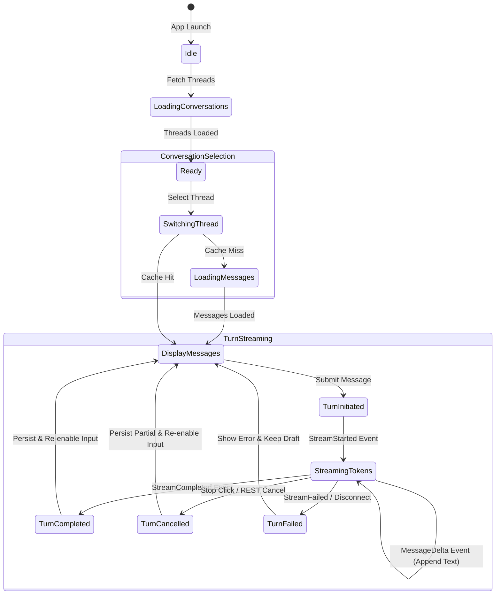

# ORBIT Milestone M1.6 — Desktop Chat Interface Architecture & Implementation Blueprint

---

## 1. Executive Summary & Readiness Verdict

### 1.1 Milestone Objective
Milestone **M1.6: Desktop Chat Interface** delivers ORBIT's first production-grade, desktop-first AI chat application. Building upon the frozen, verified foundations of M0 through M1.5, M1.6 bridges ORBIT's local inference runtime (FastAPI, SQLite WAL, Ollama, ResourceManager, and SSE Streaming Transport) with an Apple Silicon-optimized, native-feeling macOS desktop interface inside Tauri 2.

The interface enables users to:
1. Discover and select locally installed AI models (e.g. `ollama/llama3.2:3b`).
2. Create, name, switch, and delete persistent conversation threads.
3. Submit multiline prompts with keyboard shortcuts (`Enter` to send, `Shift+Enter` for newline).
4. Watch responses stream in real time with progressive token rendering, W3C SSE framing, and monotonic sequence validation.
5. Stop inference generation on demand via client-side abort and explicit REST cancellation.
6. Render rich Markdown, formatted tables, and syntax-highlighted code blocks with one-click clipboard copying.
7. Observe context window utilization and token metrics without fabricated telemetry.
8. Transition seamlessly between the new conversational workspace and the existing M0 system diagnostics dashboard.

### 1.2 Readiness Verdict
**Verdict: READY WITH LIMITATIONS**

**Rationale**:
- **Strengths**: The streaming transport engine (`StreamingConversationClient`, `SSEStreamParser`), conversation database models, atomic message sequence generator, Alembic migrations, Tauri 2 host supervisor, and authentication mechanisms are 100% complete, frozen, and verified across 303 tests.
- **Limitation & Required Backend Addition**: The backend currently possesses a full-featured `ModelRegistry` and `OllamaProvider.discover_models()` implementation, but **does not expose a REST endpoint** (`GET /api/v1/models`) to the frontend. To prevent hardcoding models or fabricating availability, M1.6 must include a lightweight, read-only `GET /api/v1/models` endpoint backed by the existing `ModelRegistry.discover_models()` method.

---

## 2. Existing Frontend & Desktop Architecture Audit

### 2.1 Repository Layout & Technology Stack
| Layer | Technology | Current Configuration / Version |
|---|---|---|
| **Desktop Host** | Tauri 2.0 | `tauri.conf.json` (v2), window size 1200x800, min 900x600, strict CSP |
| **Frontend Framework** | React 18.3.1 | Single-page application using `@vitejs/plugin-react` |
| **Language** | TypeScript 5.6.3 | Strict type checking (`tsc --noEmit`), target `ES2020`, bundler resolution |
| **Styling** | Custom CSS & Tokens | `index.css` CSS custom properties, glassmorphism utilities, dark mode palette (No Tailwind) |
| **Icons** | Lucide React | `lucide-react` v0.454.0 |
| **Client Transport** | Custom Fetch & SSE | `BackendClient` (HTTP/WS), `StreamingConversationClient` (SSE reader) |
| **Testing** | Vitest 2.1.4 + RTL | `jsdom` environment, `@testing-library/react` 16.0.1, 47 tests passing |

### 2.2 Security & Content Security Policy (CSP)
As defined in `apps/desktop/src-tauri/tauri.conf.json`:
```
default-src 'self';
script-src 'self';
style-src 'self' 'unsafe-inline';
connect-src 'self' http://127.0.0.1:* ws://127.0.0.1:*;
img-src 'self' data:;
font-src 'self';
object-src 'none';
frame-ancestors 'none';
```
**Implications**:
- Strict loopback confinement: Zero external web connections allowed by the webview.
- No remote script or style loading: All assets, fonts, and syntax highlighters must be bundled locally.
- Markdown rendering must strictly forbid raw inline script execution and sanitize untrusted HTML.

### 2.3 Backend API Coverage & Missing Endpoints
An audit of `contracts/openapi.json` and backend routes reveals the following state:

| Resource | HTTP Method & Path | Status in Codebase | Notes |
|---|---|---|---|
| **Health Check** | `GET /api/v1/health` | Implemented | Public loopback probe for supervisor |
| **Detailed Health** | `GET /api/v1/health/detailed` | Implemented | Authenticated diagnostics (memory, CPU, WAL) |
| **System Info** | `GET /api/v1/system/info` | Implemented | Host platform specs, memory capacity |
| **Audit Events** | `GET /api/v1/system/audit` | Implemented | Paginated immutable audit trail |
| **Conversations List** | `GET /api/v1/conversations` | Implemented | Paginated (`limit`, `offset`), sorted by `updated_at` |
| **Create Conversation**| `POST /api/v1/conversations` | Implemented | Accepts `title`, `model_id` |
| **Get Conversation** | `GET /api/v1/conversations/{id}` | Implemented | Returns metadata + message count |
| **Update Conversation**| `PATCH /api/v1/conversations/{id}`| Implemented | Updates `title` or `model_id` |
| **Delete Conversation**| `DELETE /api/v1/conversations/{id}`| Implemented | Cascade deletes thread and messages |
| **List Messages** | `GET /api/v1/conversations/{id}/messages` | Implemented | Paginated by `before_sequence` |
| **Sync Message** | `POST /api/v1/conversations/{id}/messages` | Implemented | Synchronous turn |
| **Streaming Message**| `POST /api/v1/conversations/{id}/messages/stream` | Implemented | W3C SSE token streaming |
| **Cancel Turn** | `POST /api/v1/conversations/{id}/cancel` | Implemented | Explicit turn cancellation |
| **Model Discovery** | `GET /api/v1/models` | **MISSING** | **Required for M1.6 model selector** |

---

## 3. Application Layout & Visual Design Direction

### 3.1 Design Philosophy: macOS Native Restraint
ORBIT is a local-first personal intelligence runtime, not an oversaturated SaaS marketing tool. The UI follows Apple's Human Interface Guidelines (HIG) for macOS desktop applications:
- **Clean Structure**: 2-column split view (Sidebar + Workspace) with a persistent bottom status bar.
- **Window Chrome**: Native title bar integration with draggable window region (`data-tauri-drag-region`) and proper margin around macOS window controls (traffic lights).
- **Subtle Surface Hierarchy**:
  - Sidebar: Deep background (`--bg-secondary: #12141a`).
  - Conversation Workspace: Pure canvas (`--bg-primary: #0a0b0e`).
  - Active Cards & Panels: Elevated translucent surface (`--bg-card: rgba(18, 20, 26, 0.7)` with `backdrop-filter: blur(12px)`).
  - Borders: Crisp, hairline micro-borders (`--border-subtle: rgba(255, 255, 255, 0.08)`).
- **Typography**: Apple system font stack (`-apple-system`, `BlinkMacSystemFont`, `SF Pro Text`, `SF Pro Display`) for UI; SF Mono / `ui-monospace` for code and telemetry metrics.
- **Dual Theme Support**: Full dark mode (primary) with clean, high-contrast light mode tokens.

### 3.2 Wireframe Layout Architecture

```
┌────────────────────────────────────────────────────────────────────────────────────────┐
│  ORBIT Desktop Window (1200 x 800)                                                     │
├────────────────────────┬───────────────────────────────────────────────────────────────┤
│ [● ● ●] (macOS Controls)│ [Sidebar Toggle] [Model: llama3.2:3b ▾]      [Tokens: 8K ctx] │
├────────────────────────┼───────────────────────────────────────────────────────────────┤
│ ⬡ ORBIT v0.1.0         │                                                               │
│                        │                      CONVERSATION WORKSPACE                   │
│ [+ New Chat] (Cmd+N)   │                                                               │
│                        │   [Welcome Screen OR Scrollable Message History]              │
│ 🔍 Search chats...     │                                                               │
│                        │   ┌───────────────────────────────────────────────────────┐   │
│ RECENT CONVERSATIONS   │   │ User Prompt                                     14:02 │   │
│ ────────────────────── │   │ "Explain the difference between WAL and rollback journal"│
│ • SQLite WAL Deep Dive │   └───────────────────────────────────────────────────────┘   │
│   2m ago • 4 turns     │                                                               │
│ • Python Asyncio Hooks │   ┌───────────────────────────────────────────────────────┐   │
│   1h ago • 12 turns    │   │ ⬡ Assistant (llama3.2:3b)                       14:02 │   │
│ • M1.6 UI Architecture │   │ In SQLite, Write-Ahead Logging (WAL) differs from...  │   │
│   Yesterday            │   │ ```sql                                                │   │
│                        │   │ PRAGMA journal_mode=WAL;                              │   │
│                        │   │ ```                                                   │   │
│                        │   │ [Copy] • [245 tokens • 42 t/s • 1.2s]                 │   │
│                        │   └───────────────────────────────────────────────────────┘   │
│                        │                                                               │
│                        ├───────────────────────────────────────────────────────────────┤
│                        │  MESSAGE COMPOSER                                             │
│                        │  ┌─────────────────────────────────────────────────────────┐  │
│                        │  │ Ask Orbit anything... (Shift+Enter for newline)         │  │
│                        │  │                                                         │  │
│ ────────────────────── │  │ [Estimated: 14 tokens]             [Stop ⏹ / Send ⬆]    │  │
│ [⚙ System Diagnostics] │  └─────────────────────────────────────────────────────────┘  │
├────────────────────────┴───────────────────────────────────────────────────────────────┤
│ STATUS BAR: ONLINE • WS: 1ms • DB: 0.4ms • OLLAMA: ONLINE • MEMORY: 16 GB • COST: ₹0/MO │
└────────────────────────────────────────────────────────────────────────────────────────┘
```

### 3.3 Responsive Breakpoints
- **Desktop Expanded (>= 1100px)**: Sidebar visible (width: 260px), full conversation workspace, visible model details and token metrics.
- **Desktop Compact (900px - 1099px)**: Sidebar auto-collapsible via toolbar icon or `Cmd+B`, composer narrows with centered 768px reading column.
- **Minimum Window Constraint**: Hard-enforced in Tauri config (`minWidth: 900`, `minHeight: 600`).

---

## 4. Component Hierarchy & Modular Architecture

The frontend directory will be organized into feature domains:

```
apps/desktop/frontend/src/
├── App.tsx                        # Main view router (Chat vs System Diagnostics)
├── main.tsx                       # React DOM entry point
├── index.css                      # Global design tokens, dark/light theme variables
├── context/
│   ├── ChatContext.tsx            # Global conversation & messaging state provider
│   └── ThemeContext.tsx           # Dark/light mode theme provider
├── hooks/
│   ├── useBackend.ts              # Existing Tauri IPC & health connection hook
│   ├── useWebSocket.ts            # Existing telemetry WebSocket hook
│   ├── useConversations.ts        # Conversation thread CRUD operations
│   ├── useStreamingChat.ts        # M1.5 SSE streaming orchestration hook
│   └── useModels.ts               # Model discovery and selection hook
├── components/
│   ├── layout/
│   │   ├── AppLayout.tsx          # Root shell layout with sidebar and main view
│   │   ├── TitleBar.tsx           # Native-looking window drag area and controls
│   │   ├── Header.tsx             # Existing system header (used in diagnostics)
│   │   └── StatusBar.tsx          # Persistent application status bar
│   ├── sidebar/
│   │   ├── Sidebar.tsx            # Navigation sidebar container
│   │   ├── ConversationList.tsx   # Grouped, searchable conversation list
│   │   ├── ConversationItem.tsx   # Thread item with active state & inline rename/delete
│   │   └── NewChatButton.tsx      # Prominent "New Chat" button with shortcut label
│   ├── chat/
│   │   ├── ChatWorkspace.tsx      # Main conversation workspace container
│   │   ├── ChatToolbar.tsx        # Top conversation toolbar (model selector, actions)
│   │   ├── WelcomeScreen.tsx      # Empty state with prompt starter chips
│   │   ├── MessageList.tsx        # Virtualized/scrollable message stream container
│   │   ├── MessageItem.tsx        # Single conversational turn block (User/Assistant)
│   │   ├── StreamingMessage.tsx   # Real-time streaming assistant turn with cursor
│   │   ├── MessageComposer.tsx    # Auto-growing multiline input with send/stop buttons
│   │   └── ContextMeter.tsx       # Subtle token headroom & context usage gauge
│   ├── markdown/
│   │   ├── MarkdownRenderer.tsx   # Secure AST markdown renderer (safe headings/lists/tables)
│   │   └── CodeBlock.tsx          # Syntax highlighted code block with one-click copy
│   ├── models/
│   │   ├── ModelSelector.tsx      # Dropdown popover for model selection
│   │   └── ModelBadge.tsx         # Pill badge displaying model name & parameter count
│   ├── dashboard/                 # Existing M0 Foundation diagnostic components
│   │   ├── HostCard.tsx
│   │   ├── BackendCard.tsx
│   │   ├── DatabaseCard.tsx
│   │   ├── SecurityCard.tsx
│   │   └── AuditFeed.tsx
│   └── ui/                        # Reusable atomic UI primitives
│       ├── Badge.tsx
│       ├── Button.tsx
│       ├── Card.tsx
│       ├── ConfirmDialog.tsx      # Accessible modal for destructive actions
│       ├── ErrorBoundary.tsx
│       ├── Input.tsx
│       ├── Metric.tsx
│       └── Tooltip.tsx
├── services/
│   ├── backend.ts                 # Base HTTP client with session auth
│   ├── conversation.ts            # Dedicated conversation CRUD service
│   ├── models.ts                  # Model discovery service
│   ├── streaming.ts               # Existing M1.5 StreamingConversationClient
│   └── websocket.ts               # Existing telemetry WebSocket client
└── types/
    ├── api.ts                     # Generated OpenAPI contracts
    ├── contracts.ts               # M0 system contracts
    ├── conversation.ts            # UI conversation domain models
    └── streaming.ts               # Existing M1.5 streaming event types
```

---

## 5. Frontend State Architecture & Data Flow

### 5.1 State Model (`ChatContext`)
Rather than introducing heavy external dependencies (Redux, Zustand), state is managed via React Context + `useReducer` to enforce predictable, atomic transitions:

```typescript
export interface ChatState {
  // Navigation & Views
  activeView: 'chat' | 'system';
  sidebarOpen: boolean;

  // Conversations
  conversations: ConversationResponse[];
  activeConversationId: string | null;
  isLoadingConversations: boolean;
  searchQuery: string;

  // Messages Cache (Keyed by conversation_id)
  messagesByConversation: Record<string, MessageResponse[]>;
  isLoadingMessages: boolean;

  // Active Streaming State
  streamingState: {
    isStreaming: boolean;
    conversationId: string | null;
    messageId: string | null;
    accumulatedText: string;
    tokenCount: number;
    allocatedContext: number | null;
    abortController: AbortController | null;
    startTime: number | null;
    error: string | null;
  };

  // Drafts (Preserved per conversation)
  drafts: Record<string, string>;

  // Models
  availableModels: ModelDescriptorResponse[];
  selectedModelId: string;
  isLoadingModels: boolean;
  modelError: string | null;
}
```

### 5.2 State Lifecycle Transitions



### 5.3 Concurrency & Race Condition Safeguards
1. **Thread Switch Isolation**: If a user switches conversations while a stream is actively writing:
   - The stream continues in the background until completed or cancelled.
   - Stream delta events inspect `envelope.conversation_id`: deltas update `messagesByConversation[envelope.conversation_id]`, but only trigger viewport DOM updates if `envelope.conversation_id === activeConversationId`.
2. **Draft Message Preservation**: The current composer text is auto-saved into `drafts[activeConversationId ?? 'new']` on every keystroke. Switching between threads immediately restores the respective draft.
3. **Double Submission Prevention**: The submit button and `Enter` key are locked immediately upon submission until `StreamStarted` or an early HTTP failure occurs.
4. **Optimistic User Turn**: When the user hits send:
   - An optimistic user message (`role="user"`, `status="completed"`) is inserted into local state.
   - If the HTTP request fails with 404/422, the optimistic message is cleanly removed and the draft is restored to the input box.

---

## 6. M1.5 Streaming Integration

The interface strictly integrates the M1.5 streaming engine without re-implementing SSE parsing or simulating deltas.

### 6.1 Integration Flow with `StreamingConversationClient`

```typescript
// Conceptual implementation in hooks/useStreamingChat.ts
const streamingClient = useMemo(() => new StreamingConversationClient(backendClient), []);

const sendMessage = async (conversationId: string, content: string, modelId?: string) => {
  // 1. Prepare optimistic user turn & assistant placeholder in local cache
  dispatch({ type: 'START_STREAMING', conversationId, content, modelId });

  const callbacks: StreamCallbacks = {
    onStarted: (payload) => {
      dispatch({
        type: 'STREAM_STARTED',
        conversationId,
        assistantMessageId: payload.assistant_message_id,
        allocatedContext: payload.allocated_context,
      });
    },
    onDelta: (deltaText, payload) => {
      dispatch({
        type: 'APPEND_DELTA',
        conversationId,
        deltaText,
        tokenCount: payload.accumulated_tokens,
      });
    },
    onCompleted: (payload) => {
      dispatch({
        type: 'STREAM_COMPLETED',
        conversationId,
        finishReason: payload.finish_reason,
        promptTokens: payload.prompt_tokens,
        completionTokens: payload.completion_tokens,
        durationMs: payload.duration_ms,
      });
    },
    onInterrupted: (payload) => {
      dispatch({
        type: 'STREAM_INTERRUPTED',
        conversationId,
        reason: payload.reason,
      });
    },
    onCancelled: (payload) => {
      dispatch({
        type: 'STREAM_CANCELLED',
        conversationId,
        reason: payload.reason,
      });
    },
    onFailed: (payload) => {
      dispatch({
        type: 'STREAM_FAILED',
        conversationId,
        errorMessage: payload.error_message,
      });
    },
    onError: (error) => {
      dispatch({
        type: 'STREAM_NETWORK_ERROR',
        conversationId,
        errorMessage: error.message,
      });
    },
  };

  try {
    const controller = await streamingClient.streamMessage(
      conversationId,
      content,
      callbacks,
      { modelId: modelId || selectedModelId }
    );
    activeAbortControllerRef.current = controller;
  } catch (err) {
    // Non-200 HTTP response before stream opened
    dispatch({ type: 'STREAM_SETUP_FAILED', conversationId, error: err.message });
  }
};
```

### 6.2 Cancellation Handling
When the user clicks the "Stop" button:
1. `activeAbortControllerRef.current?.abort()`: Immediately halts client-side reading of the response body.
2. `streamingClient.cancelTurn(conversationId)`: Dispatches `POST /api/v1/conversations/{id}/cancel` to immediately notify backend `ConversationService` and propagate cancellation to the local Ollama daemon.
3. UI immediately marks the assistant message as `interrupted` with `finish_reason="cancelled"`, retaining all partial tokens generated up to that millisecond.

---

## 7. Model Selection & Backend Discovery Integration

### 7.1 Required Backend API Addition
To allow the frontend to display authentic local models without guessing, M1.6 specifies the addition of:

**Endpoint**: `GET /api/v1/models`
- **Location**: `backend/app/api/v1/models.py` (mounted into `api_router`)
- **Security**: Requires session token auth (`require_session_auth`)
- **Backend Implementation**:
  ```python
  @router.get("", response_model=APIResponse[ModelDiscoveryResponse])
  async def list_models(request: Request) -> APIResponse[ModelDiscoveryResponse]:
      registry: ModelRegistry = request.app.state.model_registry
      discovery_result = await registry.discover_models()
      return APIResponse[ModelDiscoveryResponse](
          success=True,
          data=ModelDiscoveryResponse(
              models=[ModelDescriptorResponse.from_descriptor(m) for m in discovery_result.models],
              errors=discovery_result.errors,
              discovered_at=discovery_result.discovered_at,
          ),
          correlation_id=get_correlation_id(),
      )
  ```

### 7.2 Model Selector UI Behavior
- Located in the conversation toolbar.
- Shows a list of discovered local models (e.g. `ollama/llama3.2:3b`, `ollama/qwen2.5:7b`).
- Displays rich descriptor metadata:
  - Model Name & Family (e.g. "Llama 3.2 3B").
  - Parameter Size & Quantization (e.g. "3.2B • Q4_K_M").
  - Context Window Capacity (e.g. "128K context").
  - Resident Memory Indicator: Highlights models currently loaded in RAM (from `/api/ps`).
- Switching model updates `ConversationUpdate(model_id=...)` via `PATCH /api/v1/conversations/{id}`.
- If Ollama is offline or no models are installed, the selector gracefully displays "No models found (Ollama offline)" with a link to check system diagnostics.

---

## 8. Markdown Rendering & Code Block Security

### 8.1 Safe AST Markdown Architecture
To render rich responses without risking XSS or violating Tauri's CSP:
1. Use `react-markdown` + `remark-gfm`.
2. Do **NOT** install or enable `rehype-raw`. Unsafe HTML tags generated by the model (e.g. `<script>`, `<iframe sandbox>`) are treated as plain text or ignored.
3. Link Sanitization: External `href` links are inspected. They must never navigate the desktop window away from the app. Clicking external links delegates to Tauri's Opener plugin (`@tauri-apps/plugin-opener` or `window.open` with sanitized target) after confirming the URL protocol is strictly `http:` or `https:`.

### 8.2 Code Block UX
- Rendered in a dedicated macOS-styled container:
  - Header bar with language identifier (e.g., `python`, `typescript`, `sql`, `json`).
  - "Copy Code" button with a clipboard icon that transitions to a green checkmark and "Copied!" for 2 seconds.
  - Syntax highlighting using bundled, lightweight styling.
  - Horizontal scrolling enabled with subtle scrollbars (`overflow-x: auto`), preserving code indentation.

---

## 9. Context Window & Token Budget Visibility

### 9.1 Authoritative Metrics Presentation
In accordance with non-negotiable guidelines, ORBIT will never fabricate token counts or context utilization.
- **Pre-Turn Estimation**: While the user types in the composer, the UI calculates a conservative token count estimate using the exact heuristic from `ContextManager.estimate_tokens(text)`:
  $$\text{Estimated Tokens} = \left\lceil \frac{\text{length}}{3.5} \right\rceil + 4$$
- **Turn Allocated Context**: Populated authoritatively from the `stream.started` event's `allocated_context` (e.g. 8,192 tokens).
- **Post-Turn Token Accounting**: Below each completed assistant turn, a subtle pill displays authoritative numbers from `StreamCompletedPayload` and `MessageResponse`:
  - `Prompt Tokens`: Evaluated input tokens.
  - `Completion Tokens`: Generated output tokens.
  - `Speed`: Computed as $\text{Completion Tokens} / (\text{Duration ms} / 1000)$ tokens/sec.
- **Context Usage Gauge (`ContextMeter`)**:
  - An unobtrusive gauge in the conversation toolbar: `1,420 / 8,192 tokens (17%)`.
  - Warns in amber if context usage approaches the 75% sliding-window boundary where older history will begin pruning.

---

## 10. Tauri Desktop Integration & Native macOS Polish

### 10.1 Native TitleBar & Traffic Light Spacing
- In macOS desktop mode, standard browser title bars are replaced with a seamless native toolbar.
- The top 40px of the header is marked with `data-tauri-drag-region`, allowing users to drag the application window naturally across displays.
- Interactive elements (buttons, model dropdown, sidebar toggle) are styled with `user-select: none` and excluded from dragging.
- Left padding of 78px is reserved on the top-left to avoid colliding with macOS window management buttons (close, minimize, zoom).

### 10.2 Global Keyboard Shortcuts
To deliver a true desktop experience, global keyboard shortcuts are handled via a top-level listener:
- `Cmd + N`: Create new conversation thread.
- `Cmd + B`: Toggle sidebar collapse/expand.
- `Cmd + K`: Focus conversation search input.
- `Cmd + Enter`: Send message from composer.
- `Escape`: Cancel active streaming generation / Close active modals.

### 10.3 Desktop Host Lifecycle & Crash Recovery
- Seamlessly reuses existing `useBackend` hooks.
- If the Python backend restarts (detected via Tauri event `orbit://backend-restarted`), `useBackend` automatically re-fetches the connection token, and the chat interface reconnects without requiring a window reload.

---

## 11. Error Handling & Recovery UX

Every potential failure mode is designed with clear, non-technical recovery paths:

| Failure Mode | Visual Indication | User Action / Recovery |
|---|---|---|
| **Backend Daemon Down** | Amber/Red indicator in status bar: "Backend Reconnecting..." | Composer disabled; status bar directs user to Diagnostics view |
| **Ollama Daemon Offline** | Model selector shows "Ollama Offline"; warning banner above composer | Actionable button: "Retry Connection" or "Open Diagnostics" |
| **Model Not Downloaded** | Warning banner: "Model `llama3.2:3b` is not installed" | Prompts user to run `ollama pull llama3.2:3b` in Terminal |
| **Memory Pressure Reject** | Assistant error: "System memory limit reached (16GB budget protected)" | Informs user that Resource Manager prevented OOM; prompt preserved |
| **Mid-Stream Disconnect** | Assistant turns amber: "Inference interrupted" | Partial text preserved; "Retry Turn" button available |
| **Unexpected Stream EOF** | Assistant turns amber: "Generation cut off prematurely" | Partial text saved with `status="failed"`; draft preserved |
| **Conversation Not Found** | 404 toast notification | Clears active selection and redirects to New Chat |

---

## 12. Testing Architecture & Verification Matrix

The M1.6 frontend test suite will expand `apps/desktop/frontend` tests from 47 to >75 tests using Vitest and React Testing Library:

| Test Category | Target Component / Hook | Test Scenarios |
|---|---|---|
| **Sidebar & Nav** | `Sidebar.tsx`, `ConversationList.tsx` | - Renders threads in chronological order<br>- Creates new conversation on `+ New Chat`<br>- Filters list on search input<br>- Renames conversation on double click / edit button<br>- Shows confirmation modal on delete and removes thread<br>- Collapses and expands cleanly |
| **Model Selector**| `ModelSelector.tsx`, `useModels.ts` | - Fetches and displays discovered local models<br>- Displays parameter size and context capacity<br>- Highlights selected model<br>- Gracefully handles empty model list or daemon offline |
| **Message History**| `MessageList.tsx`, `MessageItem.tsx` | - Renders user and assistant bubbles<br>- Renders Welcome screen when message history is empty<br>- Renders markdown headings, lists, tables<br>- Renders code blocks with language tags and copy button<br>- Scrolls to bottom on new messages without hijacking user scroll |
| **Composer** | `MessageComposer.tsx` | - Auto-grows on multiline input<br>- Submits on Enter, inserts newline on Shift+Enter<br>- Disables Send button when input is empty or during generation<br>- Displays Stop button during generation<br>- Preserves draft when submission fails |
| **Streaming Hook**| `useStreamingChat.ts` | - Orchestrates `streamMessage` with `StreamingConversationClient`<br>- Progressively appends deltas on `message.delta`<br>- Finalizes status and tokens on `stream.completed`<br>- Handles user stop click via `cancelTurn` and AbortController<br>- Traps mid-stream exceptions and marks `failed`<br>- Prevents cross-conversation delta bleeding on rapid thread switch |
| **Theme & Window**| `ThemeContext.tsx`, `TitleBar.tsx` | - Toggles dark and light mode CSS tokens<br>- Applies `data-tauri-drag-region` properly |
| **Regression** | `App.test.tsx` | - Validates that existing M0 Foundation checks remain intact when switching to Diagnostics view |

---

## 13. Performance Budget & Resource Guidelines

Target Hardware: **Apple Silicon MacBook Air M4 (16GB RAM, 512GB SSD, macOS Sequoia)**

1. **Token Rendering Frame Rate**:
   - Streaming token updates must not trigger layout thrashing or full conversation re-renders.
   - Message items are memoized (`React.memo`), ensuring that incoming `message.delta` events only re-render the single active `StreamingMessage` block.
2. **Scroll Optimization**:
   - Auto-scroll follows a "stick-to-bottom" heuristic: If the user is within 100px of the bottom, auto-scroll follows incoming tokens. If the user scrolls up to review prior history, auto-scroll is paused.
3. **Memory Footprint**:
   - Webview memory consumption is capped below 150MB by garbage-collecting offscreen Markdown ASTs and unmounting inactive conversation message lists.
4. **Zero Cloud Latency**:
   - All assets, fonts, icons, and bundles are strictly local; cold launch renders in under 200ms.

---

## 14. Exact File Changes Required for M1.6

### 14.1 Backend Files (Minimal Read-Only Model Discovery)
- `backend/app/schemas/models.py` *(New)*: Pydantic schemas for `ModelDescriptorResponse` and `ModelDiscoveryResponse`.
- `backend/app/api/v1/models.py` *(New)*: `GET /api/v1/models` route querying `ModelRegistry`.
- `backend/app/api/router.py` *(Modified)*: Include `models.router`.
- `contracts/openapi.json` & `apps/desktop/frontend/src/types/api.ts` *(Regenerated)*.

### 14.2 Frontend Files Created / Modified
- `apps/desktop/frontend/package.json` *(Modified)*: Add `react-markdown`, `remark-gfm`, and lightweight syntax highlighter.
- `apps/desktop/frontend/src/index.css` *(Modified)*: Add light-theme variables, code block styling, scrollbar tokens.
- `apps/desktop/frontend/src/App.tsx` *(Modified)*: Support switching between `chat` (primary) and `system` (diagnostics).
- `apps/desktop/frontend/src/context/ChatContext.tsx` *(New)*: Central state management for conversations, streaming, and models.
- `apps/desktop/frontend/src/context/ThemeContext.tsx` *(New)*: Light/dark mode toggle provider.
- `apps/desktop/frontend/src/hooks/useConversations.ts` *(New)*: Thread management hook.
- `apps/desktop/frontend/src/hooks/useStreamingChat.ts` *(New)*: Streaming chat lifecycle hook.
- `apps/desktop/frontend/src/hooks/useModels.ts` *(New)*: Local model discovery hook.
- `apps/desktop/frontend/src/services/conversation.ts` *(New)*: Typed conversation CRUD client.
- `apps/desktop/frontend/src/services/models.ts` *(New)*: Model discovery client.
- `apps/desktop/frontend/src/components/layout/AppLayout.tsx` *(New)*: 2-column macOS application shell.
- `apps/desktop/frontend/src/components/layout/TitleBar.tsx` *(New)*: macOS drag region and view switcher.
- `apps/desktop/frontend/src/components/sidebar/Sidebar.tsx` *(New)*: Chat history sidebar.
- `apps/desktop/frontend/src/components/sidebar/ConversationList.tsx` *(New)*: Searchable thread list.
- `apps/desktop/frontend/src/components/sidebar/ConversationItem.tsx` *(New)*: Thread item with inline rename & delete.
- `apps/desktop/frontend/src/components/chat/ChatWorkspace.tsx` *(New)*: Main conversation container.
- `apps/desktop/frontend/src/components/chat/ChatToolbar.tsx` *(New)*: Model selector & thread header.
- `apps/desktop/frontend/src/components/chat/WelcomeScreen.tsx` *(New)*: Clean empty-state prompt starters.
- `apps/desktop/frontend/src/components/chat/MessageList.tsx` *(New)*: Scrollable message container.
- `apps/desktop/frontend/src/components/chat/MessageItem.tsx` *(New)*: User/Assistant turn renderer.
- `apps/desktop/frontend/src/components/chat/StreamingMessage.tsx` *(New)*: Live streaming turn with cursor.
- `apps/desktop/frontend/src/components/chat/MessageComposer.tsx` *(New)*: Multiline input with send/stop.
- `apps/desktop/frontend/src/components/chat/ContextMeter.tsx` *(New)*: Context token gauge.
- `apps/desktop/frontend/src/components/markdown/MarkdownRenderer.tsx` *(New)*: Safe markdown component.
- `apps/desktop/frontend/src/components/markdown/CodeBlock.tsx` *(New)*: Highlighted code block with copy button.
- `apps/desktop/frontend/src/components/models/ModelSelector.tsx` *(New)*: Popover model selector.
- `apps/desktop/frontend/src/components/ui/ConfirmDialog.tsx` *(New)*: Accessible delete confirmation dialog.
- `apps/desktop/frontend/src/components/ui/Button.tsx` *(New)*: Accessible macOS-styled button.

---

## 15. Dependencies Required
1. `react-markdown`: Safe AST-based Markdown parsing.
2. `remark-gfm`: Tables, tasklists, autolinks, strikethrough.
3. Syntax Highlighting: `prismjs` + `@types/prismjs` (lightweight, zero WASM, works completely offline within strict CSP).

---

## 16. Risks & Mitigations

| Risk | Impact | Mitigation Strategy |
|---|---|---|
| **High Token Rate UI Lag** | Rapid incoming tokens (60+ t/s) cause high CPU load | Batch text deltas using `requestAnimationFrame` if streaming exceeds 50 tokens/sec. |
| **XSS from Untrusted Model Output** | Arbitrary script execution | `react-markdown` strictly disallows raw HTML by default. No `rehype-raw` enabled. |
| **External Link Navigation** | Webview navigates away from app | All markdown links intercept click events and either open in default system browser or do nothing. |
| **Stale Async Stream Collision** | Tokens from previous chat bleed into newly selected chat | Every incoming SSE chunk is checked against `activeConversationId` before viewport DOM dispatch. |
| **Ollama Daemon Not Running** | Model selector empty; user confused | Distinct "Ollama Offline" banner with actionable instructions and diagnostics link. |

---

## 17. Implementation Acceptance Criteria

1. **Visual & Layout**:
   - Clean 2-column macOS layout (Sidebar + Chat Workspace) matching dark and light themes.
   - Draggable title bar with correct macOS traffic light margin.
2. **Conversation Lifecycle**:
   - Can create a new chat, switch between existing chats, edit titles, and delete chats with confirmation.
   - Conversations are durably stored in SQLite WAL and reload seamlessly across app restarts.
3. **Streaming & Cancellation**:
   - Messages stream incrementally using M1.5 `StreamingConversationClient`.
   - Clicking "Stop" halts streaming immediately, cancels backend inference, and preserves partial output with status `interrupted`.
4. **Markdown & Code**:
   - Responses render formatted text, headers, lists, and tables.
   - Code blocks display language tags, syntax highlighting, and working "Copy Code" buttons.
5. **Model Selection**:
   - Model dropdown lists actual discovered local models from Ollama with parameter count and context window.
6. **Context & Metrics**:
   - Displays authentic token counts and generation speeds upon turn completion.
   - No simulated or fake metrics.
7. **Quality & Verification**:
   - All existing 246 backend tests, 47 frontend tests, and 10 Rust tests pass.
   - Comprehensive new frontend test suite (>25 tests) passes under Vitest.
   - `bash scripts/verify_m0.sh` passes all stages.

---

**End of Architecture Discovery Document**

